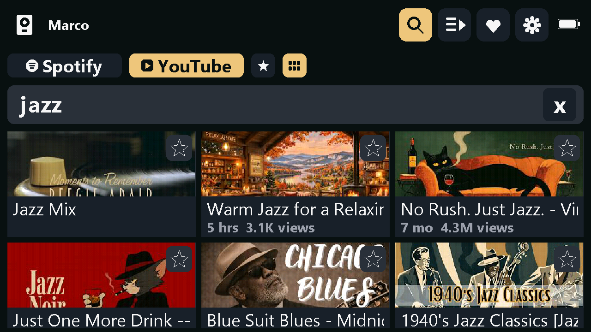

# M5Tab Sonos Controller

A wall controller for the [M5Stack Tab5](https://docs.m5stack.com/en/core/Tab5) that plays **YouTube on your Sonos speakers**. Search on the tablet, tap a video, and the room plays the audio. No phone, no PC and no extra box in the middle. It is also a full Sonos remote: rooms and grouping, transport, volume, the queue, favorites and Spotify.

  

> **Status:** a hobby project that works well on the author's unit. It has been tested on one Tab5 and one Sonos system. Expect rough edges, and please open an issue if you find one.

<p align="center">
  
</p>

## What it does

- **YouTube, on the speakers.** Search YouTube on the Tab5. Each result has a thumbnail, the channel, the length, how old the video is and, when YouTube sends it, the view count. A second view lays the same results out three across, large enough to pick by the picture. Tap a row or a picture to play. Tap the star to keep it. Saved videos sit in a Starred list, with their thumbnails, and they survive a reboot (up to 24). While a video plays, the home screen shows the YouTube mark, the title, the channel, the thumbnail and a star. The sound comes out of the Sonos room. The tablet has to stay powered and on the network for the whole video. See [YouTube, and why it is fragile](#youtube-and-why-it-is-fragile).
- **Sonos control.** Finds your speakers on the local network, shows every room, and controls the one you pick: play, pause, next, previous, volume, now playing with album art, the room's queue, and your Sonos favorites.
- **Rooms.** Tapping a room only selects it. A **+** adds that room to the playing group. A **−** takes it out.
- **Spotify.** Search Spotify with an on-screen keyboard, open songs, albums, playlists and artists before playing (an artist gives its albums and radio), play now or add to the Sonos queue, and browse your own playlists. Covers show when Spotify provides them. Playback runs through your Sonos system.
- **Setup without a computer.** On first start the Tab5 opens its own Wi-Fi network and a small web page where you choose your home Wi-Fi.

## What you need

- An **M5Stack Tab5** (ESP32-P4, 1280x720 display). This project was proven on the earlier hardware revision (chip revision v1.3, board id `m5stack-tab5-p4`). A newer revision needs a different PlatformIO board. See [docs/tab5-control.md](docs/tab5-control.md).
- A **Sonos** system on the same network. The firmware talks to the speakers' local control port, so the Tab5 must be on the same subnet. It was tested against a household of seven rooms running current Sonos software.
- A **2.4 GHz Wi-Fi** network. The Tab5's radio does not use 5 GHz.
- A computer with a USB-C cable, once, to flash it.
- Optional, for Spotify: a Spotify account that is already linked in the Sonos app, and a free Spotify developer app (see below).

## Install

1. Install [PlatformIO](https://platformio.org/install) (the CLI or the VS Code extension) and Python 3.
2. Clone this repository.
3. Plug the Tab5 into your computer over USB-C.
4. Build and flash:

   ```powershell
   python -m platformio run -e tab5 -t upload
   ```

   If more than one serial port is present, add `--upload-port COMx` (Windows) or `--upload-port /dev/ttyACMx` (Linux/macOS).

**Windows notes.** Set `PYTHONUTF8=1` first, or the upload fails after a successful build:

```powershell
$env:PYTHONUTF8 = 1
python -m platformio run -e tab5 -t upload
```

`platformio.ini` sets `core_dir = C:/pio` so the Arduino toolchain does not hit Windows' 260-character path limit. If you have long paths enabled, or you are on Linux or macOS, delete that line. The first build downloads a large toolchain (around 2 GB).

If the upload cannot find the board, hold the boot button while resetting it. More build and flashing details are in [docs/tab5-control.md](docs/tab5-control.md).

## First start

1. While the Tab5 is joining Wi-Fi, the screen is a splash titled **Sonos Control**. With no network stored, it asks you to join a Wi-Fi network named like `TabSonos...`. Join it with your phone.
2. Open `http://192.168.4.1` (most phones open it for you), choose your home network and type the password.
3. The Tab5 joins your network, the setup network closes, and the room list appears. The Tab5 remembers the network.

You can also set the network over USB serial with `W ssid|password`. See [Serial commands](#serial-commands).

## Using it

- **Left side:** the rooms. Tap a room to control it. A **+** adds it to the group. A **−** takes it out.
- **Middle:** what is playing, with album art, title, artist, the source (YouTube, Spotify, radio and so on) and the clock.
- **Now playing:** previous, play/pause and next sit with the track. On the home screen the volume slider runs along the bottom, with mute at its right end. Browse covers the slider. Dragging the slider while the room is muted turns the sound back on.
- **Top left:** a speaker and the name of the room you are controlling. Tap it to leave Browse, Queue, Favorites or Settings and return to the home screen.
- **Top right:** icons for **Browse** (magnifier), **Queue**, **Favorites** (heart) and **Settings** (gear), then the battery. The battery is an icon only. The address of the Tab5 is on the Device tab in Settings.
- **Settings.** Three tabs. **Wi-Fi** joins, forgets or reconnects a network. **Screen** sets how long the backlight stays on, whether a tap clicks (off, a low tone, or a higher one), and what happens once that time is up. On battery the screen turns off. Plugged in, it can show the picture of the YouTube or Spotify track that is playing. **Device** shows the battery, memory, signal and uptime. The next tap wakes the screen without pressing whatever is underneath. A button lights up while it is pressed, and the speaker makes a short click.
- **Rotation.** The screen starts upside down from the panel's native landscape, which is how this tablet is mounted. Turn it over and it follows. The layout stays landscape.

### YouTube

Tap **Browse**, then **YouTube**. The list starts empty. Tap the search field, type, and press **Search**.

- Tap a row, or a picture in the grid, and the tablet leaves search and shows the home screen with transport and volume.
- The star on a result saves the video. The star beside the title on the home screen does the same for whatever is playing. The star chip opens the saved list. Tap a saved row to play it, or its star to remove it.
- The grid chip switches between the text list and three pictures per row. Each card shows the age and the view count under the title.

| Search | Three across |
| --- | --- |
|  |  |

<p align="center">
  
</p>

### Spotify

Tap **Browse**, then **Spotify**. The list starts empty. Tap the search field, type, and press **Search**.

- The triangle plays the item now. The plus adds it to the Sonos queue.
- Tapping a song, album, or artist opens it. An artist shows albums and radio. A playlist you own opens its tracks. Spotify does not share the track list of someone else's playlist; play still starts it.
- Songs, albums, playlists and artists show their cover when Spotify provides one.
- The list chip opens **My playlists**.

| Search | Open an item |
| --- | --- |
|  |  |

## Spotify setup

Spotify needs a one-time sign-in so the Tab5 can browse your account. Nothing is stored in this repository. Your sign-in lives only in the Tab5's own flash memory.

1. In the Sonos app, add Spotify as a music service and sign in.
2. Create a free app at the [Spotify developer dashboard](https://developer.spotify.com/dashboard), while signed in to the Spotify account you use. Add this redirect URI to the app: `http://127.0.0.1:8888/callback`.
3. With the Tab5 connected over USB, run:

   ```powershell
   pip install pyserial
   python tools/spotify_auth.py --client-id YOUR_CLIENT_ID --port COM12
   ```

   Your browser opens, you approve, and the script sends the sign-in to the Tab5 over USB. Leave `--client-secret` out unless the dashboard shows one.

To sign out later, send `X` over serial.

Spotify app rules apply. An app in development mode is limited to a small list of approved users, so add your own account there.

## YouTube, and why it is fragile

Search, thumbnails and the grid are the surface. Under them, YouTube has no official way to play its audio on a Sonos speaker, and the speaker cannot play a YouTube address by itself. This project does it like this:

1. When you tap a result, the Tab5 asks YouTube's internal player endpoint (InnerTube) for the video's address, pretending to be a mobile YouTube app.
2. YouTube refuses to serve the speaker directly, because Sonos does not send the byte-range requests YouTube requires. So the Tab5 acts as a small web server on port 8080. The speaker is told to play `http://<tab5>:8080/yt/...`, and the Tab5 downloads the video's MP4 file from YouTube into a 6 MB buffer in its memory. It then pulls the audio track out of that file and sends it to the speaker as a plain AAC stream, the way an internet radio station would. (Handing over the MP4 itself works for about twelve minutes. The speaker then runs out of its sample table and stops, so a long video would cut off.)
3. The Tab5 must stay powered and on the network while YouTube plays.

What that means in practice:

- It uses an **undocumented** interface. YouTube can change or block it at any time, and it may stop working without warning. The client names and versions it presents are in a table in `src/youtube.cpp`, and you can try a different one at runtime with the `Yc` serial command, without reflashing.
- Some videos will not play, for example age-restricted or region-locked ones, and videos where YouTube asks the client to prove it is not a bot. The status line says "No audio allowed for this video".
- Live streams have not worked in testing.
- The Tab5 downloads the combined 360p MP4, because the audio-only format dropped out on the speaker in testing. It only passes the audio on, but the whole file is read, so a long video uses its video bytes too.
- It is played as a radio-style stream, so the speaker shows no length and cannot seek.
- Using it may go against YouTube's Terms of Service. It is meant for personal use at home. You are responsible for how you use it.

## Serial commands

The Tab5 listens on its USB serial port (115200 baud). Open it **without** toggling DTR/RTS, because the ESP32-P4's built-in USB resets the chip when they change. `tools/tab5serial.py` has an `open_port` helper that does this.

| Command | What it does |
| --- | --- |
| `W ssid\|password` | Join a Wi-Fi network. `W` alone joins the stored one. |
| `F` | Forget the stored Wi-Fi network. |
| `T` | Test the TLS connection to Spotify. |
| `S spotify\|client_id\|refresh_token\|secret` | Store the Spotify sign-in (used by `tools/spotify_auth.py`). |
| `X` | Sign out of Spotify. |
| `Y <videoId>` | Resolve and play a YouTube video. |
| `Yq <words>` | Search YouTube. |
| `Yk` | Star or unstar the playing YouTube video. |
| `Yc name\|version\|ua` | Use a different YouTube client for the player request. |
| `Ys` | Seek the speaker to five minutes (a test command, no effect on the radio-style stream). |
| `P` | Send a screenshot of the screen over serial (used by `tools/screenshot.py`). |
| `U x y` | Inject a tap at screen position x, y (1280x720). |

## How it works

| Part | Where | Notes |
| --- | --- | --- |
| Display and touch | `src/ui.cpp`, `src/display_fb.cpp`, `src/font_ui.h` | M5GFX. The screen is one 1280x720 off-screen canvas pushed to the panel. |
| Wi-Fi and setup page | `src/net.cpp` | Station mode, plus a captive-portal access point for setup. |
| Sonos | `src/sonos.cpp` | SSDP discovery, then UPnP/SOAP on port 1400: transport, rendering, queue, favorites, zone topology. |
| Spotify | `src/services.cpp` | Web API over HTTPS. Items are handed to Sonos as queue entries. |
| YouTube | `src/youtube.cpp` | InnerTube search and player calls, a relay server, a read-ahead buffer, and the starred list in NVS. |
| Board setup | `src/board.cpp` | A guard for the shared I2C bus. |
| Tools | `tools/` | `spotify_auth.py` (one-time Spotify sign-in), `tab5serial.py` (serial helper), `screenshot.py` (takes a screenshot of the Tab5 over USB, with optional taps first; needs Pillow), `make_font.py` (rebuilds `font_ui.h`). |

Network work runs on its own task, away from the drawing code, so the screen stays responsive.

The hardware notes in [docs/tab5-control.md](docs/tab5-control.md) were written while bringing the board up. They cover the display, touch, the shared I2C bus, USB serial, memory, power and a list of failure modes. They are useful if you are starting your own Tab5 project.

## Troubleshooting

- **Black screen or no serial output after flashing.** Run one clean upload with nothing else holding the port. Stop any other PlatformIO or serial program first.
- **"Access denied" or "port busy" when uploading.** Another program still has the serial port open.
- **No rooms appear.** The Tab5 and the speakers must be on the same network and subnet. A guest network or a client-isolation setting hides the speakers.
- **Wi-Fi will not connect.** Use a 2.4 GHz network. Send `F` over serial to forget the network and start the setup page again.
- **YouTube says "No audio allowed" for everything.** YouTube may have changed something. Check the serial log, and see the `Yc` command.

## Contributing

Issues and pull requests are welcome. If you add support for another Tab5 hardware revision, or for another service, a note in the pull request about what you tested on is very helpful.

## Credits

Built with [M5Unified](https://github.com/M5Stack/M5Unified), [M5GFX](https://github.com/M5Stack/M5GFX), [ArduinoJson](https://arduinojson.org/) and the [pioarduino](https://github.com/pioarduino/platform-espressif32) platform.

## Disclaimer

This is an independent project. It is not affiliated with or endorsed by Sonos, Spotify, Google or M5Stack. Sonos, Spotify, YouTube and M5Stack are trademarks of their owners. YouTube playback relies on an unofficial interface and may break or be restricted at any time.

## License

[MIT](LICENSE). You may use, copy, modify and distribute this project for any purpose, including commercial use, as long as the copyright and license notice stay with it.
